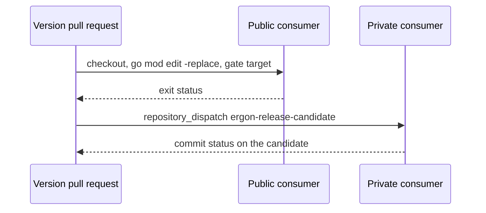

<!--
  ~ Copyright Dokimasia B.V. 2026
  ~ SPDX-License-Identifier: MIT
-->

# RFC-0017: Testing the consumers before a release

## Summary

The module has tagged releases with changelogs since v0.1.0. A release
can still break the tests of a consumer, and the consumer learns of it
when it upgrades. This proposal adds two rules:

- The version pull request of a release runs the tests of every known
  consumer against the release, and a failing consumer blocks the
  release. ergon runs the check, from a list of consumers in
  `.ergon.yaml`.
- A change that removes a public name or an environment variable keeps
  the old one for one more minor release, marked deprecated.

ergon has no such check today, so the first rule is a request to ergon,
and this module lists its consumers once ergon reads the list.

## Motivation

### A consumer finds a change of behaviour through its own failing tests

Nine modules in six repositories require `go.dokimi.dev/assert` on
2026-10-11:

| Repository | Modules | Requirement | Visibility |
|---|---|---|---|
| thesm-os/core | the root | a pseudo-version of 70257cc | Public |
| thesm-os/kanon | the root | v0.1.1 | Public |
| thesm-os/sharder | the root | v0.1.1 | Private |
| thesm-os/ledger | `evidence`, `storage` | a pseudo-version of 70257cc | Private |
| dokimasia/ergon | the root | a pseudo-version of 4abc39f | Public |
| dokimasia/eidos | `eidos-cli`, `eidos-core`, `eidos-conformance` | a pseudo-version of 6f23571 | Public |

Each of them met a change of behaviour of this module through its own
tests:

- `Rejects` changed from the rendered message to the failure records. The
  ledger moved on 2026-10-06, and 12 claims of its mutant tests had to
  change.
- The variable on which the allocation ceilings skip changed from
  `DOKIMI_MUTATE_MUTANT` to `DOKIMI_MUTATE_INSTRUMENTED`, so the allocation
  tests of a consumer detected other mutants.
- Minimal version selection raised the ledger's requirement of this
  module through core, without a change of the ledger's own requirement.

CI of this module runs `ergon check`, the race detector, the fuzzer,
`govulncheck` and the check of the vendored definition. Every one of them
covers this module's own code.

### The release flow has no step for a consumer

ergon opens a version pull request from the pending changesets. When the
pull request merges, ergon tags and publishes each package. The jobs that
version and publish wait for the CI run of their commit to pass, and that
run covers the repository's own code. Neither the release design nor its
configuration names a repository that requires a package of the release.

## Detailed design

### The list of consumers

`.ergon.yaml` gains a list of the repositories that require a package of
the repository:

```yaml
release:
  consumers:
    - repository: thesm-os/core
    - repository: thesm-os/kanon
    - repository: thesm-os/sharder
      private: true
    - repository: thesm-os/ledger
      modules: [evidence, storage]
      private: true
    - repository: dokimasia/ergon
    - repository: dokimasia/eidos
      modules: [eidos-cli, eidos-core, eidos-conformance]
```

- `repository` is the GitHub repository, as `owner/name`.
- `modules` lists the directories of the modules that require a package
  of the release. The root is the default.
- `private` states that the repository is private.

### The check

ergon's CI workflow gains a job, `consumers`, that runs on the version
pull request alone:

- For a public consumer, the job checks out the default branch of the
  consumer. In each listed module it replaces each released module with
  the checkout of the release, through `go mod edit -replace`, and runs
  the consumer's own gate target.
- For a private consumer, the job sends a `repository_dispatch` event of
  type `ergon-release-candidate` to the consumer, with the commit of the
  version pull request. The consumer's own CI runs its gate against that
  commit and sets a commit status on it. The job waits for the status of
  each private consumer.
- A consumer whose gate fails, or that does not set a status within the
  limit of the job, fails the job. The version pull request then cannot merge, so
  no tag is created.

A private consumer runs the check in its own CI, so its code and its test
output do not appear in the logs of a public repository. The consumer
needs a workflow that runs on the event. ergon init writes that workflow
when the consumer's `.ergon.yaml` lists the repositories that may send
the event.



### Deprecation for one release

The code standard gains a rule in its section on names:

- A change that removes or renames a public name keeps the old name for
  the next minor release. The old name calls the new one, and its doc
  comment has a paragraph that begins with `Deprecated:`.
- A change that renames an environment variable reads both the old and
  the new variable for the next minor release.
- A change of meaning that a new major version of the definition requires
  does not keep the old meaning. Its changeset starts with
  `**Breaking:**`.

### Release notes

The text of each changeset that vendors a definition contains the
version, as in "Implement definition 8.0.0 and write its version into
every call record." The changelog of a release then states the version of
the definition that the release implements.

### Changes to this repository

- `.ergon.yaml` gains the list of consumers once ergon reads it.
- `docs/standards/code.md` gains the deprecation rule.
- No code of this module changes.

## Alternatives considered

### A. A local job in this repository

The job would be declared in `.ergon/local/.github/workflows/ci.yml`, as
the job `spec` is.

**Why not:** every repository with consumers needs the same job, and core
and kanon have consumers too. A local copy in each repository is a second
implementation of one release step.

### B. Running the private consumers in this repository's CI

The job would check out a private consumer with a token and run its
tests here.

**Why not:** the logs of a public repository's CI are public, so the
test output of a private repository would appear in them.

### C. Testing the consumers after the tag

A job would run the consumers after the release, and report a failure as
an issue.

**Why not:** a consumer that upgrades between the tag and the issue meets
the failure first, as it does today.

## Drawbacks

- **Time.** The version pull request waits for the gates of nine modules
  in six repositories.
- **Coupling.** A consumer with a failing gate of its own blocks every
  release of this module until the consumer is fixed.
- **Private consumers.** Each private consumer needs the workflow that
  runs on the event, and a token that can send it.
- **ergon.** The check waits for the feature in ergon.

## References

| What | Where |
|---|---|
| The discussion | <https://github.com/dokimasia/assert-go/issues/20> |
| The request to ergon for the list of consumers and the job | <https://github.com/dokimasia/ergon/issues/20> |
| ergon's release flow: the version pull request, and the jobs that wait for the CI run of their commit | <https://github.com/dokimasia/ergon/blob/main/docs/rfc/0002-release.md> |
| The requirements of the consumers | The `go.mod` files of each repository on its default branch, read through the GitHub API on 2026-10-11 |
| Go's convention for a deprecated name | <https://go.dev/wiki/Deprecated> |
